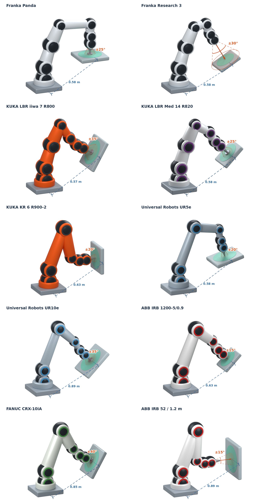

# 机器人表面任务方向与距离配置

这 10 份配置把**机器人本体参数**与**用户给定的任务方向约束**分开保存。机械臂会在物体表面工作；本目录用一个固定世界坐标中的方向锥，表达该工位允许的工具朝向。每份配置同时保存底座位置、工作面位置、工具长度、离面距离和圆形工作窗口。工位参数都是可修改的初始估计，尚未用真实底座、TCP 标定和 IK 求得可达工作区。调研日期：2026-10-16。



## 坐标与方向

沿用项目的右手世界坐标：`+Z` 向上，`XY` 是水平面；本目录的 `+X/+Y` 是用户工位坐标，不自动等于厂家的机器人底座坐标。用户指定世界坐标之后，约束固定在该坐标中。

- `working_direction_world = a`：单位向量，**工具 → 物体表面**，例如 `[0, 0, -1]` 是向下加工。
- `cone_half_angle_deg = α`：允许工具方向相对 `a` 的最大偏角；全开角是 `2α`。
- `surface_incidence_half_angle_deg = β`：工具方向与表面**内法向**的最大夹角。它表示工艺对正、偏斜的容许范围。
- 若表面外法向为 `n`，理想的正向加工方向是 `-n`，表面朝向工具的方向是 `+n`。这里的工作方向和项目的装卸／退出方向是不同变量。

一个指定的工具方向 `d` 通过方向检查，需要同时满足：

```text
||a|| = ||d|| = ||n|| = 1
d · a    >= cos(α)      # 固定工位的工具方向锥
d · (-n) >= cos(β)      # 局部表面的工艺入射角
```

仅询问某个表面是否**存在一个**可用工具方向时，两方向锥相交即可：

```text
angle(a, -n) <= α + β
```

这个存在性判断不是“所有加工方向都可实现”。若任务规定相对内法向 `b` 的半角 `γ` 内**全部**方向都须实现，完整覆盖条件为 `angle(a, b) + γ <= α`。

每张图画出机械臂、工具与工作表面。橙色锥与圆弧表示允许的工具方向，**不是喷雾扩散角**；绿色圆盘表示估计工作窗口。蓝色虚线和距离标记连接底座安装面中心与工作面中心。图中只保留机器人名称、`±α` 和一个距离值。工位位置、离面距离、工具长度及窗口按米制配置绘制；机械臂本体仍是六／七关节的外观示意，不是精确 CAD 或 IK 解。

## 十个初始配置

表中数值保留三位小数；JSON 保存单位向量的完整精度。每一行是一个具体型号加一个假定工位，并非该型号唯一的工作方式。半角的差异用于构造不同任务约束，不能据此比较不同机器人的灵巧程度。

| 配置 | 轴数／名义臂展 | 估计工具工作方向 `a` | 半角 α／入射 β | 假定任务 | 图片 |
|---|---|---|---|---|---|
| [01 Franka Panda](01_franka_panda.json) | 7／0.855 m | `[0, 0, -1]` | 25°／10° | 台面上表面抛光 | [单独图](figures/01_franka_panda.png) |
| [02 Franka Research 3](02_franka_fr3.json) | 7／0.855 m | `[0.500, 0, -0.866]` | 30°／10° | 上方斜向非接触检测 | [单独图](figures/02_franka_fr3.png) |
| [03 KUKA LBR iiwa 7 R800](03_kuka_iiwa7_r800.json) | 7／0.800 m | `[0.866, 0, -0.500]` | 35°／15° | 侧上方曲面抛光 | [单独图](figures/03_kuka_iiwa7_r800.png) |
| [04 KUKA LBR Med 14 R820](04_kuka_lbr_med14_r820.json) | 7／0.820 m | `[0, -0.707, -0.707]` | 25°／10° | 沿用项目型号的表面探测 | [单独图](figures/04_kuka_lbr_med14_r820.png) |
| [05 KUKA KR 6 R900-2](05_kuka_kr6_r900_2.json) | 6／0.901 m | `[1, 0, 0]` | 20°／10° | 竖直侧面涂胶 | [单独图](figures/05_kuka_kr6_r900_2.png) |
| [06 Universal Robots UR5e](06_ur5e.json) | 6／0.850 m | `[-0.259, 0, -0.966]` | 20°／10° | 上方点胶 | [单独图](figures/06_ur5e.png) |
| [07 Universal Robots UR10e](07_ur10e.json) | 6／1.300 m | `[0, 0.707, -0.707]` | 35°／15° | 大工件斜向打磨 | [单独图](figures/07_ur10e.png) |
| [08 ABB IRB 1200-5/0.9](08_abb_irb1200_5_90.json) | 6／0.900 m | `[0.707, 0, -0.707]` | 15°／5° | 固定斜面精细涂胶 | [单独图](figures/08_abb_irb1200_5_90.png) |
| [09 FANUC CRX-10iA](09_fanuc_crx10ia.json) | 6／1.249 m | `[-0.866, 0, -0.500]` | 40°／15° | 侧上方曲面砂磨 | [单独图](figures/09_fanuc_crx10ia.png) |
| [10 ABB IRB 52 / 1.2 m](10_abb_irb52_120.json) | 6／1.200 m | `[0, 1, 0]` | 15°／10° | 正对竖直面喷涂 | [单独图](figures/10_abb_irb52_120.png) |

上述一般机械臂用于描述相应表面任务。专用喷涂型号单独选用 IRB 52；它的 15°／10°仍然是本项目的工位与工艺初值。

## 距离与工作面积

需要分别设定两种距离：**底座到工作面的位置关系**影响可达区域；**工具工作端到表面的离面距离**影响工具所需姿态和工艺覆盖。距离不是实际工作面积的唯一决定因素，工具朝向、长度、关节范围、工件遮挡及碰撞也会改变可用区域。UR 官方的 [Operating Space](https://www.universal-robots.com/manuals/EN/HTML/SW10_15/Content/prod-usr-man/complianceG7/H_g5_sections/mechanical_interface_g5/workspace.htm) 特别说明：外侧工作区的工具姿态会受限，底座上方的中心柱也有运动限制。因此不把名义臂展当作可用球面，不用一个距离直接推断最大加工面积。

下面是已写入 10 份 JSON 的初值。底座均直立安装，安装面中心位于世界原点；工作面中心相对底座的高度为 0.25–0.40 m。小臂的水平偏置取 0.48–0.55 m，大臂取 0.75–0.80 m，再选择较小的局部圆形窗口，为后续实际姿态验证留出余量。**这些工位距离和窗口尺寸是本项目的布局估计，不是厂家规定或已验证的最大工作区。**

| 配置 | 底座→面中心直线距离 | 工具工作端→表面：名义值（范围） | 估计工作窗口直径 | 窗口面积 |
|---|---:|---:|---:|---:|
| 01 Panda，接触抛光 | 0.583 m | 0 mm（接触） | 240 mm | 0.045 m² |
| 02 FR3，视觉检测 | 0.577 m | 200 mm（150–250） | 200 mm | 0.031 m² |
| 03 iiwa 7，接触抛光 | 0.566 m | 0 mm（接触） | 240 mm | 0.045 m² |
| 04 LBR Med，接触探测 | 0.583 m | 0 mm（接触） | 200 mm | 0.031 m² |
| 05 KR 6，涂胶 | 0.626 m | 2 mm（1–3） | 240 mm | 0.045 m² |
| 06 UR5e，点胶 | 0.583 m | 2 mm（1–3） | 240 mm | 0.045 m² |
| 07 UR10e，接触打磨 | 0.894 m | 0 mm（接触） | 400 mm | 0.126 m² |
| 08 IRB 1200，精细涂胶 | 0.626 m | 1 mm（0.5–1.5） | 200 mm | 0.031 m² |
| 09 CRX-10iA，接触砂磨 | 0.850 m | 0 mm（接触） | 360 mm | 0.102 m² |
| 10 IRB 52，空气雾化喷涂 | 0.894 m | 180 mm（150–200） | 400 mm | 0.126 m² |

喷涂距离参考 [Graco Automatic XT 喷枪手册第 17 页](https://www.graco.com/content/dam/graco/tech_documents/manuals/311/311051/historic/311051EN-C.pdf) 的 150–200 mm 及近法向喷涂要求。它是**所假定的空气雾化喷枪**的工艺参考，不能套用于所有喷枪或当成 ABB 本体限制。点胶的毫米级范围和视觉检测的距离均为未指定工具时的估计，实际须由胶材、针头或镜头工作距离确定；接触任务的 TCP 就在接触面上，故离面为 0。

配置中相关字段：

- `feasibility.base_pose_world`：底座安装面中心的位置与估计朝向。
- `feasibility.tcp_transform`：假定直工具沿法兰 `+Z`，长度 80–160 mm；TCP 在工具工作端。它是估计安装变换，须替换为真实标定。
- `task_constraint.world_position_constraint`：世界坐标中的工作面圆盘，保存中心、外法向、半径，以及底座到中心的直线距离。`normal_tolerance_m = 0.005` 是窗口厚度容差，不是工具接触精度。
- `task_constraint.tcp_to_surface_distance_m`：沿工具轴从 TCP 到加工点的距离，含 `min / nominal / max`，单位 m；它不包含工具自身长度。

名义工具方向为 `a`、工作面中心为 `c`、离面距离为 `s`、工具长度为 `L` 时：

```text
TCP 位置  = c - s * a
法兰位置  = c - (s + L) * a
窗口面积  = π * radius_m²        # 配置的任务窗口，不是已证明可达的面积
```

移动工件后，工作窗口仍固定在用户世界坐标，必须重新评估工件与窗口的重合及机械臂可达性。喷涂的单次喷幅还需要喷嘴／雾化参数；不能用本目录的工具偏转半角 `α` 代替喷雾扩散角来计算喷幅。TCP 可以平移，所以也不能用 `π(s tan α)²` 计算整片可加工面积。

## 常见机器人实际限制了什么

厂家主要给出逐关节角度范围、臂展、载荷及安装限制。它们不能直接转换为一个与位置无关的工具方向锥。即使某个腕关节允许大角度转动，整个工具姿态仍受其余关节、位置、工具长度和碰撞影响。

| 型号与来源 | 主要参考限制与使用口径 |
|---|---|
| [Franka Panda 数据表](https://cdn2.hubspot.net/hubfs/2896172/Brochura-Franka-Emika.pdf)、[官方 FCI](https://support.franka.de/docs/control_parameters.html#limits-for-panda) | 7 轴、3 kg、855 mm。FCI 关节范围在 JSON 中保留原始弧度；例如 J4 `[-3.0718, -0.0698] rad`，J6 `[-0.0175, 3.7525] rad`，有明显不对称性。 |
| [Franka Research 3 手册](https://www.franka.de/hubfs/Product%20Manual%20Franka%20Research%203_R02210_1.5_EN-1.pdf) | 7 轴、3 kg、855 mm。选用该手册的名义限位：J2 ±105°、J4 -176° 至 -7°、J6 25° 至 265°；实际 FCI／运动生成器限位依版本可能更窄。不能套用 Panda 的限位。 |
| [KUKA LBR iiwa 7 R800 数据表](https://www.kuka.com/-/media/kuka-downloads/imported/8350ff3ca11642998dbdc81dcc2ed44c/0000246832_en.pdf) | 7 轴、7 kg、800 mm；J1/3/5 ±170°，J2/4/6 ±120°，J7 ±175°。 |
| [KUKA LBR Med 官网](https://www.kuka.com/sv-se/branscher/robots-used-in-medicine/kuka-solutions-for-medical-robots/lbr-med-medical-robot)、[项目现有模型限位](../codes/simulation/assets/lbr_med14_r820/config/joint_limits.yaml) | 14 R820 为 7 轴、14 kg、820 mm；关节范围复用仓库 LBR-Stack 模型，来源明确标为模型参数，未冒充独立厂家控制器认证。 |
| [KUKA KR 6 R900-2 数据表](https://www.kuka.com/-/media/kuka-downloads/imported/8350ff3ca11642998dbdc81dcc2ed44c/0000290001_zhhant.pdf?hash=8F86C12E58479B2BCEA7AC8FBD1B67AA&rev=1ea7e042e9a34dcab80ba6967c1ea2d8) | 6 轴、901 mm；额定 6 kg，满足载荷中心等条件时最大 6.7 kg。J2 -190° 至 45°，J3 -120° 至 156°，J5 ±120°。 |
| [UR5e 官方规格](https://www.universal-robots.com/manuals/EN/HTML/SW5_21/Content/prod-usr-man/complianceUR5e/H_g5_sections/appendix_g5/tech_spec_sheet.htm) | 6 轴、5 kg、850 mm，所选规格各关节 ±360°。 |
| [UR10e 官方数据表](https://www.universal-robots.com/manuals/EN/TechSheets/UR10e_techsheet_pdf_online/UR10e_techsheet_en.pdf) | 6 轴、1300 mm、各关节 ±360°；这里选 12.5 kg 版本，旧机型可能是 10 kg。 |
| [ABB IRB 1200 产品手册 AE](https://library.e.abb.com/public/9f57aa32e10e4a74bd523f83906facfa/3HAC046983%20PM%20IRB%201200-en.pdf) | 选原型号 5/0.9、非 Hygienic 版本；J2 -100° 至 130°、J3 -200° 至 70°、J5 ±130°、J6 默认 ±400°。不混用新系列、卫生型或扩展旋转参数。 |
| [FANUC CRX-10iA 官网](https://www.fanucamerica.com/products/robot/crx-10ia)、[另一官方 PDF](https://www.fanucamerica.com/docs/default-source/crx-data-sheets/crx-10ia-data-sheet.pdf) | 6 轴、10 kg、1249 mm。网页列出的是总行程，不能假定为对称区间。网页 J6 为 380°，PDF 为 450°，配置按网页存总行程并记录差异；有符号关节限位保持 `null`。 |
| [ABB IRB 52 数据表](https://library.e.abb.com/public/6d0d2693c9834103b1bc623e921d3734/IRB52_DataSheet_USL.pdf) | 专用喷涂机器人，6 轴、7 kg，选名义 1.2 m 型号（图中最大半径 1225 mm）。地面安装默认 J2 -63° 至 110°、J5 ±115°；墙装 J1 限 ±20°，倾斜安装另有耦合限制，软管也限制旋转。 |

固定工位通常会选择上方朝下、上侧斜向或侧面近法向的接近方式，本目录选这些方式来构造实验案例。具体世界方向由用户工位决定；本目录没有依据厂家品牌推断一个通用朝向。

实际运动学可行域应是随位置变化的集合：

```text
D(p) = { R_world_tcp(q) * calibrated_tool_axis_tcp :
         p_world_tcp(q) = p, q_min <= q <= q_max,
         no collisions, valid load and other constraints }
```

这里的方向锥只是 `D(p)` 的任务层近似，尚未证明是其内近似，也不意味着整个名义臂展球可用。配置已补充估计底座姿态、工具变换、工作窗口及离面距离；`direction_only = false` 表示现在包含位置与距离参数，`ik_verified = false` 仍表示尚未验证实际运动学可行性。奇异点、碰撞、标定误差与连续路径仍需实际模型验证。

## 与当前 cadGrasp 任务的关系

当前 `objects/<name>/poses/pose_<i>/angle_15|30|60` 中的角度是**加工力相对表面内法向的载荷圆锥半角**，本目录 `α` 是固定工位的**工具工作方向圆锥半角**。二者属于不同约束；工具轴也不必等于实际接触力方向。若某工艺需要两者相等，应由任务显式声明后再联合检查。

本目录提供独立配置与方向筛选函数，现有 solver 尚未自动读取它们。配置不会替换原始力／力矩需求，也不会筛掉已有载荷来使验收通过。原任务若要求 30° 全载荷方向，用 25° 机器人方向锥做完整覆盖检查可能失败，这应当如实报告。工件原朝向仍按现有任务保留。

物体坐标外法向 `n_object` 用保存的姿态旋转到世界：`n_world = R_world_object @ n_object`。先变换法向，再对照固定世界方向锥；平移不影响方向。退出方向是独立变量。

## 修改与使用

直接修改对应 JSON 的 `task_constraint` 可更换方向、半角、工作窗口和离面距离；修改 `feasibility` 可更换估计底座与工具安装。改变窗口中心或底座位置时，应同步更新 `base_to_center_distance_m`。`working_direction_world` 必须是单位向量。重新画图只读取配置，保留用户修改。

```bash
# 从仓库根目录运行；绘图使用已安装的 Blender 与 Pillow
.venv/bin/python robots_config/constraints.py
.venv/bin/python robots_config/render.py
.venv/bin/python -B -m unittest robots_config.test_constraints -v
```

```python
from robots_config.constraints import (
    load_config, direction_allowed, surface_normal_compatible,
    tool_direction_allowed_at_surface, process_cone_fully_covered,
    surface_point_allowed, standoff_allowed, nominal_tool_positions,
)

robot = load_config('robots_config/01_franka_panda.json')
direction_allowed(robot, [0, 0, -1])                       # True
surface_normal_compatible(robot, [0, 0, 1])                # True：存在方向
tool_direction_allowed_at_surface(robot, [0, 0, -1], [0, 0, 1])  # True
process_cone_fully_covered(robot, [0, 0, -1], 30)          # False：无法完整覆盖
surface_point_allowed(robot, [.5, 0, .3])                # True：窗口中心
standoff_allowed(robot, 0)                               # True：接触抛光
nominal_tool_positions(robot)                            # 几何位置，未求 IK
```

`robot_specification` 保存带来源和适用口径的型号信息；`task_constraint` 保存估计工位约束；`feasibility` 声明当前验证范围；`sources` 为每份配置保留原始来源。JSON 中关节均按从底座到末端的顺序 `J1…Jn` 编号，对应 KUKA 等厂家的 `A1…An`；这不定义零位／轴向映射。

`figures/` 有 10 张单独 PNG、一张总览 PNG 和 `manifest.json`，清单保存配置、图片与绘图源码的 SHA-256。测试检查方向正负、锥边界、物体到世界的旋转、存在性与完整覆盖的区别，以及离面范围、名义工具位置和斜面窗口边界。

[无文字喷涂视频](../whole_task/robot_access_spray.mp4)另用 `slides/idea/vis/robot_access` 场景的真实 Panda 网格和原生运动学，见 [whole_task 说明](../whole_task/README.md)。
